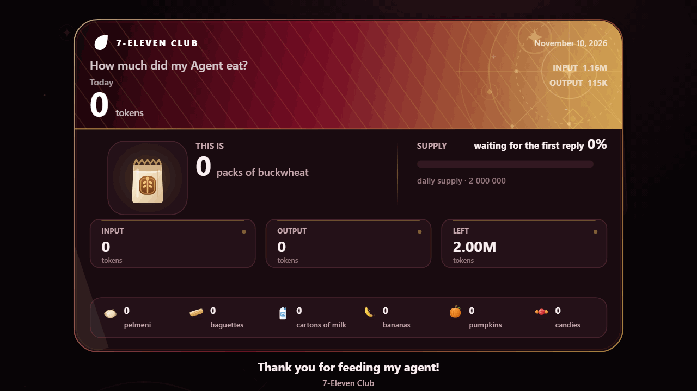
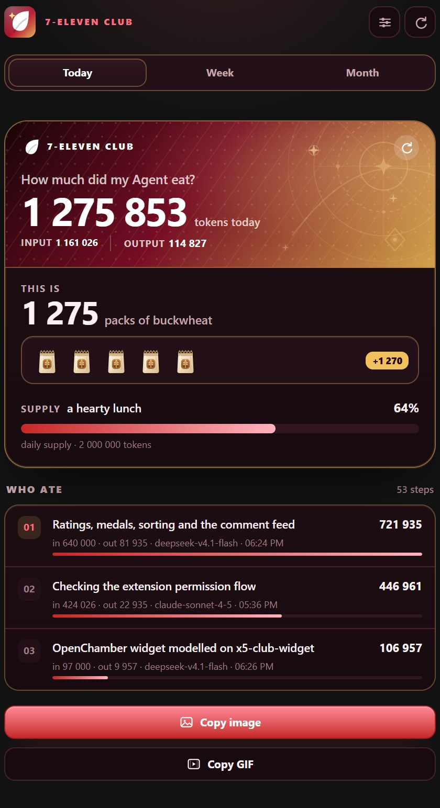
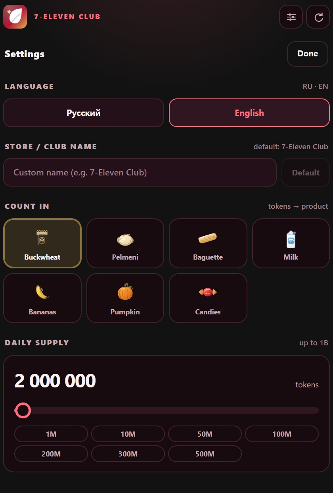
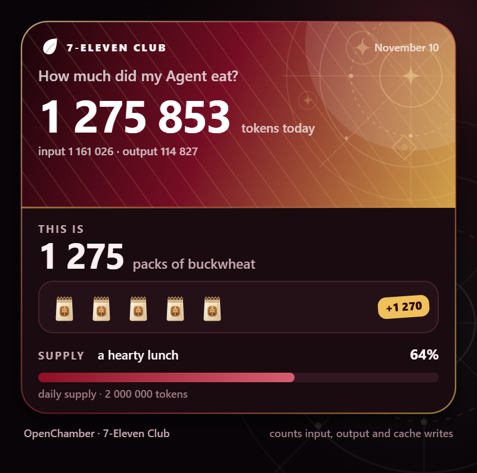
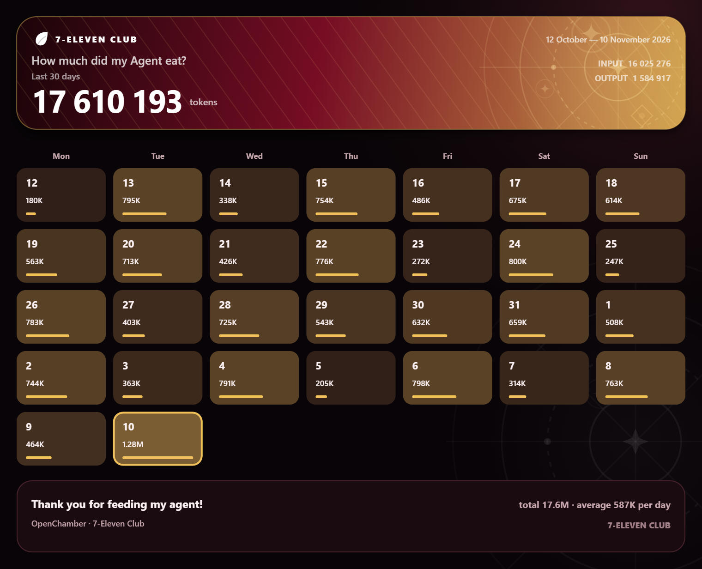
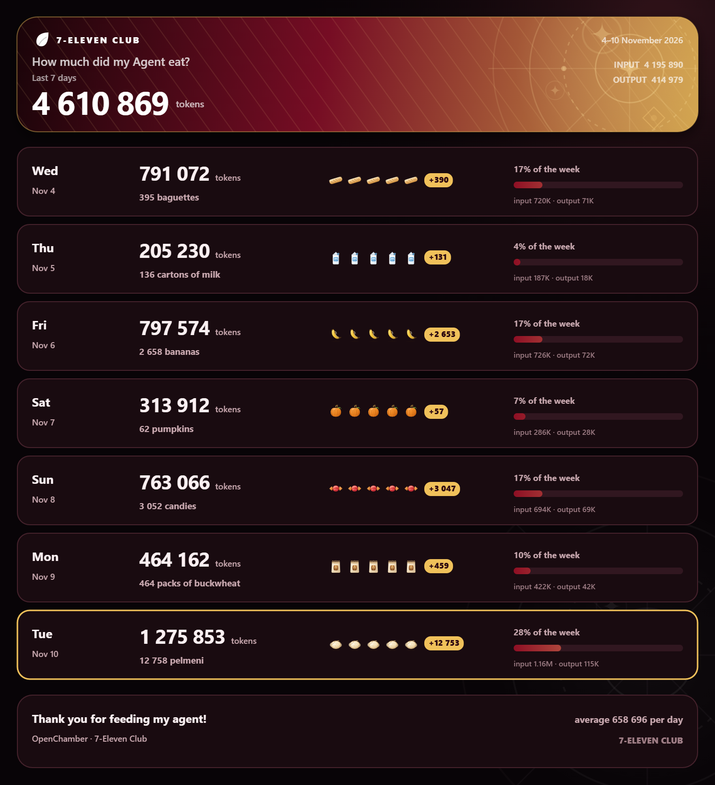
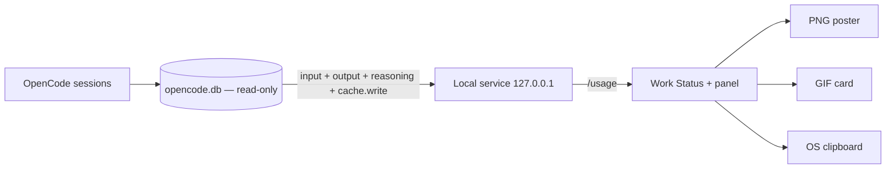

<p align="center">
  <strong>English</strong> · <a href="README.ru.md">Russian</a>
</p>

<h1 align="center">How Much Did My Agent Eat?</h1>

<p align="center">
  <strong>The token-groceries widget for OpenChamber: X5 Club in Russian, 7-Eleven Club in English, or any store name you pick.</strong><br>
  <sub>Token usage as groceries: what your agent ate today, this week or this month. Local-only, no telemetry.</sub>
</p>

<p align="center">
  
  
  
  
  
  
</p>

<p align="center">
  
</p>

<p align="center">
  <sub>Reads the local OpenCode database, renders a Work Status card and a side panel, and copies PNG and GIF posters to the clipboard.</sub>
</p>

<p align="center">
  <sub>The widget ships in Russian and English. Russian defaults to X5 Club, English to <strong>7-Eleven Club</strong>,
  and Settings lets you type any store or club name. The theme is a fan-made parody and is not affiliated
  with any retailer.</sub>
</p>

<p align="center">
  <sub>All screenshots below show the English mode. The Russian mode keeps X5 Club and the same layout.</sub>
</p>

---

## Why

OpenChamber knows how many tokens your agent burned, but not what that meal looked like.
The widget reads the local OpenCode SQLite database, converts the usage into groceries,
and puts it on one card: what was eaten, what it turned into, how much of the daily supply
is left, and which session had the biggest appetite.

No cloud, no account, no telemetry. The database is opened **read-only**, the service runs
on `127.0.0.1`, and the picture/GIF go only to the system clipboard.

<p align="center">
  <sub><a href="#what-it-does">What it does</a> · <a href="#screenshots">Screenshots</a> · <a href="#quick-start">Quick start</a> · <a href="#how-it-works">How it works</a> · <a href="#settings-and-food">Settings and food</a> · <a href="#pictures-and-gifs">Pictures and GIFs</a> · <a href="#privacy">Privacy</a> · <a href="#development">Development</a> · <a href="#troubleshooting">Troubleshooting</a> · <a href="#limitations">Limitations</a> · <a href="#credits">Credits</a> · <a href="#license">License</a></sub>
</p>

## What it does

- **Work Status** — a compact card next to the chat: tokens, input/output, the selected
  product, a shelf and the daily supply. Its header has the **Image** and refresh buttons.
- **Side panel** — **Today / Week / Month**, the card, a per-day breakdown, the **Who ate**
  session list, and copy buttons.
- **Today** — the card, the session list and the two copy buttons. The day GIF adds three
  tiles: **Input / Output / Left** and a shelf with **all six** other products.
- **Week** — the panel lists seven days with weekday, value and bars (the date is in the
  tooltip); the week poster outlines the best day and shows the average below the strip.
- **Month** — the panel shows a 30-day heatmap calendar; the month poster outlines the best
  day and prints the average in the footer.
- **Language** — Russian or English, saved per device. The English mode translates the panel,
  Work Status, PNG posters, GIFs, errors and toasts, and swaps X5 Club for **7-Eleven Club**.
- **Settings** — a separate screen behind the gear: **Language**, **Store / club name**,
  **Count in** and **Daily supply**.
- **Picture and GIF** — day, week and month designs; everything is rendered locally.

## Screenshots

<table>
  <tr>
    <td width="50%" valign="top"></td>
    <td width="50%" valign="top"></td>
  </tr>
  <tr>
    <td><sub>The panel: card, sessions, copy buttons.</sub></td>
    <td><sub>Settings: club name, language, product and daily supply, separate from the dashboard.</sub></td>
  </tr>
</table>

<p align="center">
  
</p>

<p align="center"><sub>The day poster: tokens, the selected product, its shelf and the supply.</sub></p>

<details>
<summary><strong>Posters</strong></summary>

<p align="center">
  
</p>

<p align="center">
  
</p>

</details>

## Quick start

### Requirements

- **OpenChamber 2.5+** - web or desktop. This package supports its rail panel and
  Work Status section on web and desktop; mobile and VS Code are not supported
  surfaces for the package.
- **Node 24** inside OpenChamber: the service uses the built-in `node:sqlite`.
- Permission for the **local service** — without it the database cannot be read and the
  clipboard file cannot be written.

### Install

1. Open **Settings → Extensions**.
2. Paste the absolute path to the folder you cloned or extracted (the one containing `package.json`), or a local `.zip`, and click **Add**.
3. In the permission dialog, enable the **local service**.
4. A leaf icon appears on the side panel; the **Agent Groceries** section appears in **Work Status**.
5. Open the panel, click the **gear**, and choose the language, club name, **Count in** and
   the daily supply.

After updating the extension, **restart OpenChamber completely** so the local service is
started from the new files. If the old service is still running, copying reports that the
service is out of date.

### Update

Bump `version` in `package.json` and `SERVICE_VERSION` in `service/main.ts` (`npm run check`
enforces that they match), run `npm run build`, replace the folder, and restart OpenChamber.
The built `.js` files are already in the archive — no Bun or build step is needed on the host.

### Install from a Git URL

Once the repository is public, **Settings → Extensions** accepts its HTTPS or SSH address, for example
`https://github.com/esykai/openchamber-agent-groceries`. Add `#v1.13.1` to pin a tag or `#main` to follow a
branch. OpenChamber copies the package, reads `package.json`, and shows the permission dialog.

Git installs can update themselves: raise `version` and `SERVICE_VERSION`, run `npm run build`,
commit the built `panel/main.js`, `status/main.js`, `service/main.js` and `dev/preview.js`,
then push. Folder and ZIP installs do not update.

## How it works



The service opens the OpenCode database read-only:

```
~/.local/share/opencode/opencode.db
```

The service discovers the usual OpenCode data locations under `APPDATA`, `LOCALAPPDATA`,
`XDG_DATA_HOME`, `~/.local/share`, `~/.config` and the macOS
`~/Library/Application Support/opencode` folder; the freshest existing file wins.
`OPENCODE_DB` works for a manual CLI run, but OpenChamber's host service does not inherit
that variable.

Assistant replies are read from `session_message` for the local day and summed as
`input + output + reasoning + cache.write`. **Cache reads are not counted** — otherwise
the number would grow with every re-read context. The OUTPUT number on the card and posters
includes reasoning and cache writes, so input + output equals the total. All sessions on the
machine are counted, including subagents.

## Settings and food

Settings live on a separate screen — the gear in the panel header. It contains four blocks:

- **Language** — Russian or English. Switching reloads the panel; the Work Status card picks
  up the change on its next refresh (a few seconds).
- **Store / club name** — overrides the default club name for this device (up to 28 characters);
  the reset button returns to X5 Club or 7-Eleven Club depending on the language. The name
  appears in the card header, PNG posters and GIFs.
- **Count in** — buckwheat, pelmeni, baguette, milk, bananas, pumpkin or candies.
- **Daily supply** — type it, use the slider, or pick 1 / 10 / 50 / 100 /
  200 / 300 / 500 million. The default is 10,000,000 tokens per day; the maximum is 1 billion.
  On week and month views the supply is the daily value × number of days.

The English mode uses the same arithmetic and product coefficients, but the labels and units are
in English. The default club name is **7-Eleven Club**; it is a fan-made parody, not a real partnership.
You can replace it with any name in Settings, and the name appears on the card, posters and GIFs.

The extension is listed as **Agent Groceries** and the Work Status title is **Agent Groceries**:
OpenChamber takes both from `package.json` at install time, not from the widget language.
The X5/7-Eleven names are theme defaults inside the card, not the public extension name.

The language, club name, product and supply are stored per device.

| Product | Tokens per item |
| --- | ---: |
| Buckwheat | 1,000 |
| Pelmeni | 100 |
| Baguette | 2,000 |
| Milk | 1,500 |
| Bananas | 300 |
| Pumpkin | 5,000 |
| Candies | 250 |

## Pictures and GIFs

**Copy image** renders the current period:

- **Day** — a vertical card with tokens, input/output, the product shelf and the supply.
- **Week** — a wide poster with seven rows: day, date, tokens, that weekday's food, five
  icons, the week's share, and input/output. The average sits at the bottom.
- **Month** — a 30-day heatmap calendar. Cells show only the day, tokens and a bar —
  no food icons. Today is outlined.

**Copy GIF** is the living version of the card: **1280×720, 15 seconds,
25 fps, about 3.5–4 MB**. During the first three seconds the counters and food animate and one
diagonal white beam crosses the card; then the beam disappears and the card stays calm for
another 12 seconds before the loop restarts. The week strip has labels, values, the best day
and the average; the month has a summary; the day has the stat tiles and all products. At the
end the card content fades into a blank card and reassembles, so there is no visible jump.

The clipboard receives a **real GIF file**, not a single frame. Browsers rarely support
`ClipboardItem` with `image/gif`, so the page sends the encoded GIF to the local service,
which reassembles the chunks and puts the file on the system clipboard (`SetFileDropList` on
Windows, `osascript` on macOS, `xclip` on Linux). The file stays in the system temp folder
under `openchamber-x5/` so a later paste still works.

The active skin is **crimson-and-gold orbital**: a deep ruby-to-gold hero with concentric
orbital rings, rays, diamond stars and a double gold border.

## Privacy

- The OpenCode database is opened **read-only**.
- The service listens only on `127.0.0.1` and is reached through the host proxy.
- No network, accounts, analytics or telemetry.
- Pictures and GIFs are not uploaded anywhere: only the OS clipboard.
- Nothing is pasted into the chat automatically.

## Development

```bash
npm install
npm run build       # panel, status, service
npm run typecheck
npm run check       # arithmetic, plurals, day boundaries
npm start           # http://127.0.0.1:4317/dev/preview.html
```

The preview is a sandbox, not part of the extension: pages are mounted in iframes and the
SDK bridge is replaced with a fixture. Parameters: `?surface=status|panel&theme=light|dark&tokens=…&product=…&period=…`,
`?sandbox=0` for an unsandboxed iframe, `?poster=1` to hide harness chrome, `?settings=1`
to open Settings immediately.

Publishing, Git installs and the community directory are covered in `PUBLISHING.md`.

Clipboard checks without OpenChamber: the Image button saves `dev/poster-last.png`, the GIF
button saves `dev/poster-last.gif`; `node dev/clip-test.mjs 4319 <token>` and
`node dev/gif-test.mjs 4320 <token>` push those files through a running service.

```
src/core.ts       products, plurals, formatting, day boundaries
src/card.ts       Work Status / panel card
src/poster.ts     PNG posters: day, week, month
src/gif.ts        animated card for the GIF
src/clipboard.ts  chunked upload of a rendered PNG/GIF to the local service
src/copy-image.ts PNG to clipboard
src/copy-gif.ts   GIF to clipboard
src/prefs.ts      product, period, daily supply and club name
src/usage.ts      service client and human-readable errors
src/vendor/       local gifenc build with sub-frame support
panel/            panel and settings
status/           Work Status
service/          opencode.db reader and clipboard
dev/              preview harness and checks
```

## Troubleshooting

**“The widget service is out of date”** — the extension updated but the service did not.
Restart OpenChamber completely.

**No data / "database not found"** - make sure OpenCode 2.x runs on SQLite and the build
includes `node:sqlite` (Node 24). The old JSON storage is not supported.

**The image does not copy** — enable the local service in the extension permissions. Windows
needs PowerShell; Linux needs `wl-copy` or `xclip`.

**The GIF does not paste** — the clipboard contains a real file. Some apps paste it as an
attachment rather than an image; for apps that reject files, use the PNG.

**Where are the settings?** — the gear in the panel header. The club name, product and supply live
on the settings screen.

**Why is there no food in the month poster?** — by design: poster cells show only the day,
tokens and a bar. The panel calendar keeps the weekday product icon.

**Why 25 fps instead of 60?** — 1280×720 at 60 fps makes the GIF much heavier and slower to
render; 25 fps keeps the file around 3.5–4 MB and stays smooth for the slow beam and counters.

## Limitations

- Requires a recent OpenCode 2.x SQLite database.
- Counts all sessions on the machine, including subagents; project and model do not affect
  the total.
- The day is local to the browser, not the server.
- OpenChamber extensions run in web and desktop. This package supports its rail panel
  and Work Status section there; mobile and VS Code are not supported by the package.
- “Supply” is your own reference, not a provider limit.
- The GIF is 1280×720 at 25 fps; very large numbers are shortened in the badge (`+1.02M`).

## Credits

- [grechka-coding/x5-club-widget](https://github.com/grechka-coding/x5-club-widget) — the
  original idea and the food catalog for Claude Code.
- [OpenChamber](https://openchamber.dev) and `@openchamber/sdk` — host, panel and Work Status.
- [gifenc](https://github.com/mattdesl/gifenc) — GIF encoder; this project carries a local
  build with sub-frame support.
- X5 Club - for the inspiration. This is an unofficial project, not affiliated with X5.
- **7-Eleven** is used as a fan-made theme for the English UI; this project is not affiliated with it.
  Set your own club name in Settings.

## License

MIT — see `LICENSE`. Third-party notices, including the bundled GIF encoder,
are in `THIRD_PARTY_NOTICES.md`.

This is an unofficial fan widget, not affiliated with X5 or 7-Eleven. The
original idea belongs to `grechka-coding/x5-club-widget`.
