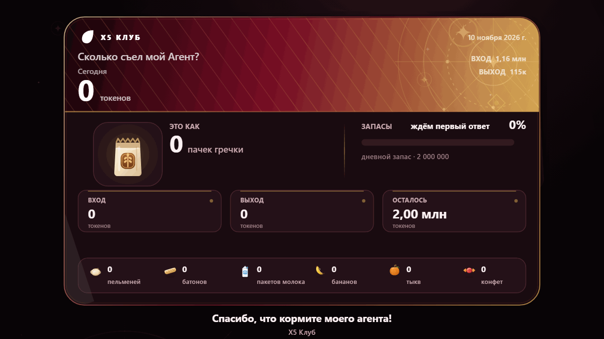
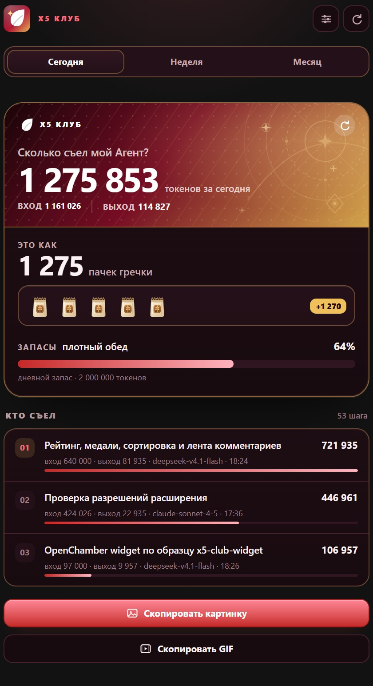
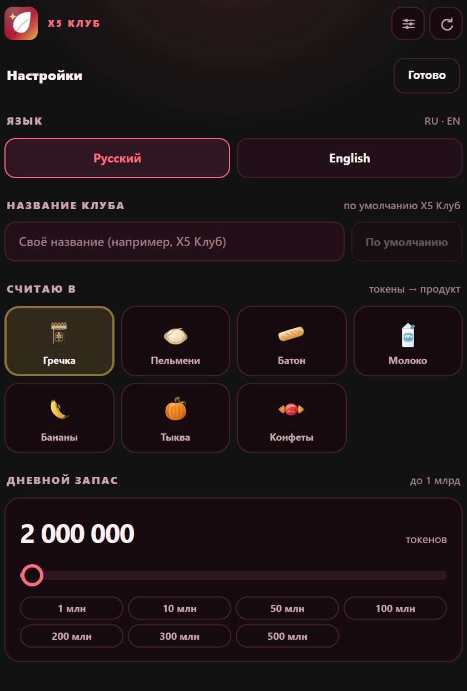
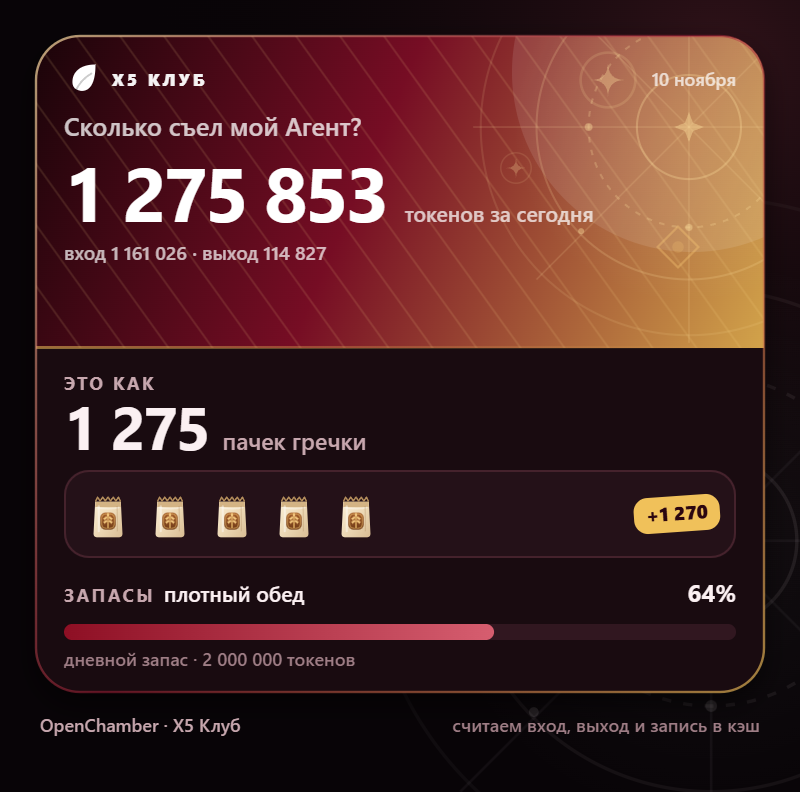
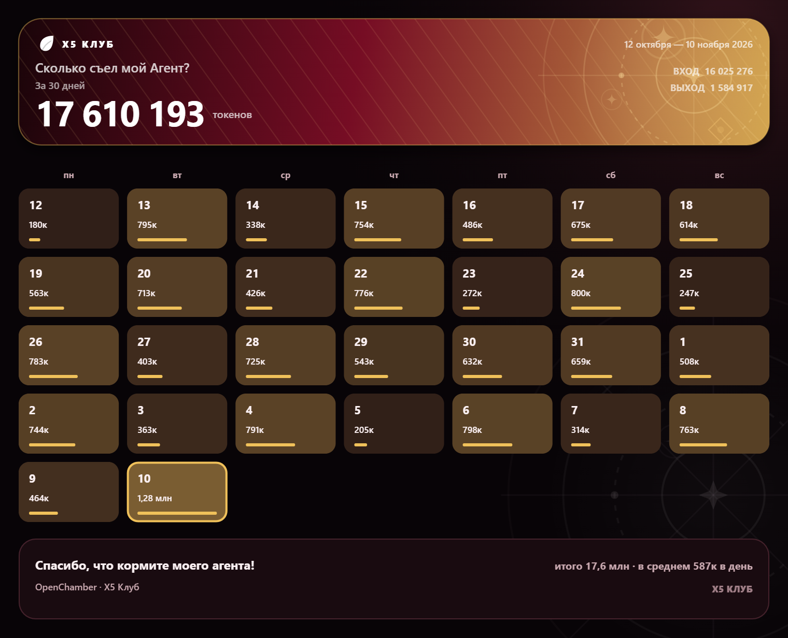
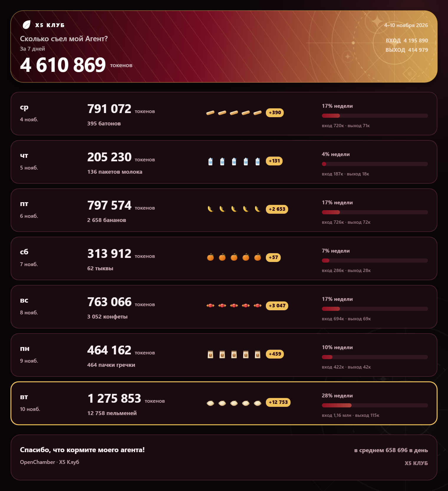
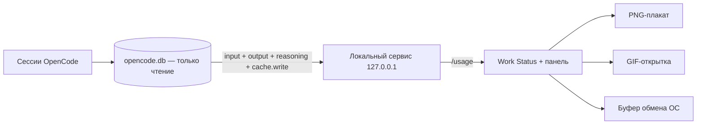

<p align="center">
  <a href="README.md">English</a> · <strong>Русский</strong>
</p>

<h1 align="center">Сколько съел мой Агент?</h1>

<p align="center">
  <strong>Виджет токенов-продуктов для OpenChamber: Х5 Клуб по-русски, 7-Eleven Club по-английски — или любое своё название.</strong><br>
  <sub>«Сколько съел мой Агент?» — расход токенов как продукты. Только локально, без телеметрии.</sub>
</p>

<p align="center">
  
  
  
  
  
  
</p>

<p align="center">
  
</p>

<p align="center">
  <sub>Читает локальную базу OpenCode, рисует карточку в Work Status и панели, отдаёт PNG и GIF в буфер обмена.</sub>
</p>

---

## Зачем

OpenChamber знает, сколько токенов сжёг агент, но не показывает, что это был за обед.
Виджет читает локальную SQLite-базу OpenCode, пересчитывает расход в продукты и складывает
это в одну карточку: сколько съедено, во что превратилось, сколько осталось от дневного
запаса и кто из сессий был самым голодным.

Без облака, аккаунтов и телеметрии. База открывается **только на чтение**, сервис живёт
на `127.0.0.1`, а картинка и GIF кладутся в системный буфер обмена.

<p align="center">
  <sub><a href="#что-умеет">Что умеет</a> · <a href="#скриншоты">Скриншоты</a> · <a href="#быстрый-старт">Быстрый старт</a> · <a href="#как-это-работает">Как это работает</a> · <a href="#настройки-и-еда">Настройки и еда</a> · <a href="#картинки-и-gif">Картинки и GIF</a> · <a href="#приватность">Приватность</a> · <a href="#разработка">Разработка</a> · <a href="#если-что-то-не-так">Если что-то не так</a> · <a href="#ограничения">Ограничения</a> · <a href="#благодарности">Благодарности</a> · <a href="#лицензия">Лицензия</a></sub>
</p>

## Что умеет

- **Work Status** — компактная карточка рядом с чатом: токены, вход/выход, выбранный
  продукт, полка и запас. В шапке есть **Картинка** и кнопка обновления.
- **Правая панель** — «Сегодня / Неделя / Месяц», карточка, разбивка по дням, список
  сессий и кнопки копирования.
- **Сегодня** — карточка, список сессий и две кнопки копирования. Дневной GIF добавляет
  три плашки «ВХОД / ВЫХОД / ОСТАЛОСЬ» и полку **всех** остальных продуктов.
- **Неделя** — панель показывает семь дней с подписями, значениями и полосками (дата —
  во всплывающей подсказке); недельный плакат выделяет лучший день и показывает среднее
  под полосами.
- **Месяц** — панель показывает календарь-хитмэп на 30 дней; месячный плакат выделяет
  лучший день и печатает среднее в футере.
- **Язык** — русский или английский, сохраняется на устройстве. В английском режиме
  переводятся панель, Work Status, PNG, GIF, ошибки и тосты, а X5 Клуб заменяется на
  **7-Eleven Club**.
- **Настройки** — отдельный экран по шестерёнке: «Язык», название клуба, «Считаю в» и «Дневной запас».
- **Картинка и GIF** — дизайн для дня, недели и месяца; всё считается и рисуется локально.

## Скриншоты

<table>
  <tr>
    <td width="50%" valign="top"></td>
    <td width="50%" valign="top"></td>
  </tr>
  <tr>
    <td><sub>Панель: карточка, сессии, копирование.</sub></td>
    <td><sub>Настройки: название клуба, язык, продукт и дневной запас — отдельно от дашборда.</sub></td>
  </tr>
</table>

<p align="center">
  
</p>

<p align="center"><sub>Дневной плакат: токены, выбранный продукт, полка и запас.</sub></p>

<details>
<summary><strong>Плакаты</strong></summary>

<p align="center">
  
</p>

<p align="center">
  
</p>

</details>

## Быстрый старт

### Что нужно

- **OpenChamber 2.5+** — web или desktop. Панель и секция Work Status в этой упаковке
  поддерживаются на web и desktop; мобильное приложение и VS Code не входят в
  поддерживаемые поверхности пакета.
- **Node 24** внутри OpenChamber: сервис использует встроенный `node:sqlite`.
- Разрешение на **локальный сервис** — без него не прочитать базу и не положить файл
  в буфер.

### Установка

1. **Настройки → Расширения**.
2. Вставьте абсолютный путь к папке, которую вы склонировали или распаковали (где лежит `package.json`), или локальный `.zip`
   и нажмите **Add**.
3. В диалоге разрешений включите **локальный сервис**.
4. Значок с листиком появится на правой панели, раздел **Agent Groceries** — в **Work Status**.
5. Откройте панель, нажмите **шестерёнку**, выберите язык, название клуба, «Считаю в»
   и дневной запас.

После обновления расширения **полностью перезапустите OpenChamber**, чтобы локальный сервис
поднялся из новых файлов. Если остался старый, копирование скажет, что сервис устарел.

### Обновление

Поднимите `version` в `package.json` и `SERVICE_VERSION` в `service/main.ts`
(`npm run check` проверяет, что они совпадают), выполните `npm run build`, замените папку
и перезапустите OpenChamber. Готовые `.js` уже лежат в архиве — Bun и сборка на месте
не нужны.

### Установка по Git-ссылке

Когда репозиторий станет публичным, **Настройки → Расширения** примут его HTTPS- или SSH-адрес,
например `https://github.com/esykai/openchamber-agent-groceries`. Добавь `#v1.13.1`, чтобы закрепить
тег, или `#main`, чтобы следить за веткой. OpenChamber скопирует пакет, прочитает `package.json`
и покажет диалог разрешений.

Git-установки обновляются сами: поднимите `version` и `SERVICE_VERSION`, выполните
`npm run build`, закоммитьте собранные `panel/main.js`, `status/main.js`, `service/main.js`
и `dev/preview.js`, затем запушьте. Установки из папки и ZIP так не обновляются.

## Как это работает



Сервис открывает базу OpenCode read-only:

```
~/.local/share/opencode/opencode.db
```

Сервис ищет обычные каталоги OpenCode в `APPDATA`, `LOCALAPPDATA`, `XDG_DATA_HOME`,
`~/.local/share`, `~/.config` и в macOS `~/Library/Application Support/opencode`;
берётся самый свежий файл. `OPENCODE_DB` работает при ручном запуске CLI, но
host-сервис OpenChamber эту переменную не наследует.

Из `session_message` берутся ответы ассистента за локальные сутки и складываются
`input + output + reasoning + cache.write`. **Чтение кэша не считается** — иначе число
пухло бы от каждого перечитанного контекста. Число OUTPUT на карточке и плакатах включает
reasoning и запись в кэш, поэтому input + output равно итогу. Считаются все сессии на
машине, включая сабагентов.

## Настройки и еда

Настройки вынесены на отдельный экран — шестерёнка в шапке панели. Там четыре блока:

- **Язык** — русский или английский. Панель перезагружается сразу, карточка Work Status
  подхватывает язык при следующем обновлении (несколько секунд).
- **Название клуба** — до 28 символов или сброс к значению по умолчанию; попадает в шапку
  карточки, PNG-плакаты и GIF на этом устройстве.
- **Считаю в** — гречка, пельмени, батон, молоко, бананы, тыква или конфеты.
- **Дневной запас** — вручную, ползунком или кнопками 1 / 10 / 50 / 100 / 200 / 300 / 500 млн.
  По умолчанию 10 000 000 токенов в день; максимум 1 млрд. На неделе и месяце запас
  считается как дневной × число дней.

В английском режиме та же арифметика и те же коэффициенты, но подписи и единицы переведены.
По умолчанию клуб называется **7-Eleven Club** — это фанатская шутка, а не партнёрство.
Любое название можно ввести в настройках; оно попадёт на карточку, плакаты и GIF.
Название расширения в списке OpenChamber и заголовок Work Status — **Agent Groceries**:
OpenChamber берёт их из `package.json` при установке, а не из языка виджета.
X5/7-Eleven — темы внутри карточки, а не публичное имя расширения.

Выбор языка, названия клуба, продукта и запаса запоминается на каждом устройстве отдельно.

| Продукт | Токенов за штуку |
| --- | ---: |
| Гречка | 1 000 |
| Пельмени | 100 |
| Батон | 2 000 |
| Молоко | 1 500 |
| Бананы | 300 |
| Тыква | 5 000 |
| Конфеты | 250 |

## Картинки и GIF

**«Скопировать картинку»** рисует плакат под текущий период:

- **День** — вертикальная карточка с токенами, входом/выходом, полкой и запасами.
- **Неделя** — широкий плакат с семью строками: день, дата, токены, своя еда для этого
  дня недели, пять иконок, доля недели, вход/выход. Внизу среднее.
- **Месяц** — календарь-хитмэп на 30 дней. В клетках только день, токены и шкала —
  без иконок еды. Сегодняшний день обведён.

**«Скопировать GIF»** — живая версия карточки: **1280×720, 15 секунд, 25 fps, около
3,5–4 МБ**. Первые три секунды цифры и еда отсчитываются, проходит один диагональный
белый луч; дальше луч исчезает, карточка спокойно живёт ещё 12 секунд и цикл повторяется.
У недели внизу подписи дней, значения, лучший день и среднее; у месяца — сводка;
у дня — плашки и все продукты. В конце карточка мягко уходит в пустую и собирается
заново, без рывка.

В буфер кладётся **настоящий GIF-файл**, а не первый кадр. Браузерный `ClipboardItem`
с `image/gif` поддерживают редко, поэтому обычно работает локальный сервис: он собирает
GIF и кладёт его файлом на системный буфер (`SetFileDropList` на Windows, `osascript`
на macOS, `xclip` на Linux). Файл остаётся в системной временной папке, внутри
`openchamber-x5/`, чтобы вставка позже не сломалась.

Активная тема — **бордово-золотой орбитальный стиль**: рубиново-золотая шапка с
концентрическими орбитами, лучами, ромбовидными звёздами и двойной золотой рамкой.

## Приватность

- База OpenCode открывается **только на чтение**.
- Сервис слушает только `127.0.0.1` и доступен хосту через его прокси.
- Нет сети, аккаунтов, аналитики и телеметрии.
- Картинка и GIF никуда не отправляются: только системный буфер обмена.
- В чат ничего не вставляется автоматически.

## Разработка

```bash
npm install
npm run build       # panel, status, service
npm run typecheck
npm run check       # арифметика, склонения, границы суток
npm start           # http://127.0.0.1:4317/dev/preview.html
```

Превью — песочница, не часть расширения: страницы монтируются в iframe, мост SDK
подменяется фикстурой. Параметры: `?surface=status|panel&theme=light|dark&tokens=…&product=…&period=…`,
`?sandbox=0` — iframe без песочницы, `?poster=1` — без служебных подписей, `?settings=1` — сразу настройки.

Публикация, установка по Git-ссылке и каталог сообщества описаны в `PUBLISHING.md`.

Клипборд проверяется без OpenChamber: кнопка «Картинка» сохраняет `dev/poster-last.png`,
кнопка «Скопировать GIF» — `dev/poster-last.gif`; `node dev/clip-test.mjs 4319 <token>`
и `node dev/gif-test.mjs 4320 <token>` прогоняют файлы через запущенный сервис.

```
src/core.ts       продукты, склонения, формат, границы суток
src/card.ts       карточка Work Status / панели
src/poster.ts     PNG-плакаты: день, неделя, месяц
src/gif.ts        анимированная карточка для GIF
src/clipboard.ts  пофрагментная отправка PNG/GIF локальному сервису
src/copy-image.ts PNG в буфер
src/copy-gif.ts   GIF в буфер
src/prefs.ts      продукт, период, запас и название клуба
src/usage.ts      клиент сервиса и ошибки
src/vendor/       локальный gifenc с поддержкой субкадров
panel/            панель и настройки
status/           Work Status
service/          чтение opencode.db и клипборд
dev/              превью-харнесс и проверки
```

## Если что-то не так

**«Сервис виджета старой версии»** — расширение обновилось, а сервис ещё старый.
Полностью перезапустите OpenChamber.

**Нет данных или «нет базы»** — проверьте, что OpenCode 2.x работает на SQLite,
а в сборке есть `node:sqlite` (Node 24). Старое JSON-хранилище не читается.

**Не копируется картинка** — включите локальный сервис в разрешениях расширения.
На Windows нужен PowerShell; на Linux — `wl-copy` или `xclip`.

**Не вставляется GIF** — в буфере настоящий файл. Некоторые приложения вставляют его
как вложение, а не как картинку; для чата, который не принимает файл, используйте PNG.

**Где настройки?** — шестерёнка в шапке панели. Там язык, название клуба, продукт
и дневной запас.

**Почему в месячном плакате нет еды?** — так задумано: в клетках плаката только день,
токены и шкала. В календаре панели иконка продукта остаётся.

**Почему 25 fps, а не 60?** — 1280×720 при 60 fps раздувает GIF и замедляет генерацию;
25 fps оставляет файл в пределах 3,5–4 МБ и остаётся плавным для медленного луча и счётчиков.

## Ограничения

- Нужна свежая база OpenCode 2.x (SQLite).
- Считаются все сессии на машине, включая сабагентов; проект и модель на итог не влияют.
- День — локальный для браузера, а не для сервера.
- Расширения OpenChamber работают в web и desktop. Панель и секция Work Status в этой
  упаковке поддерживаются там; мобильное приложение и VS Code не входят в поддерживаемые
  поверхности пакета.
- «Запас» — ваш ориентир, а не лимит провайдера.
- GIF — 1280×720, 25 fps; для очень больших чисел бейдж сокращается (`+1,02 млн`).

## Благодарности

- [grechka-coding/x5-club-widget](https://github.com/grechka-coding/x5-club-widget) —
  оригинальная идея и продукты для Claude Code.
- [OpenChamber](https://openchamber.dev) и `@openchamber/sdk` — хост, панель и Work Status.
- [gifenc](https://github.com/mattdesl/gifenc) — GIF-энкодер; в проекте лежит локальная
  версия с поддержкой субкадров.
- X5 Клуб — за вдохновение. Проект неофициальный и не связан с X5.
- **7-Eleven** — фанатская тема для английского интерфейса; проект не связан с сетью.
  Своё название можно задать в настройках.

## Лицензия

MIT — см. `LICENSE`. Уведомления сторонних библиотек, включая встроенный
GIF-энкодер, лежат в `THIRD_PARTY_NOTICES.md`.

Это неофициальный фанатский виджет, не связанный с X5 или 7-Eleven.
Оригинальная идея принадлежит `grechka-coding/x5-club-widget`.
